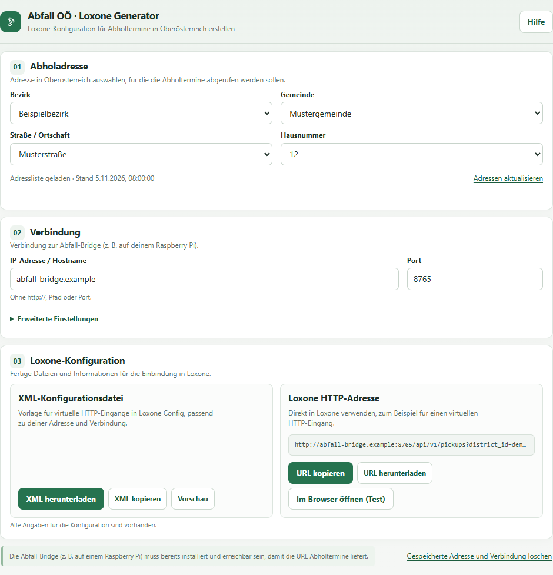
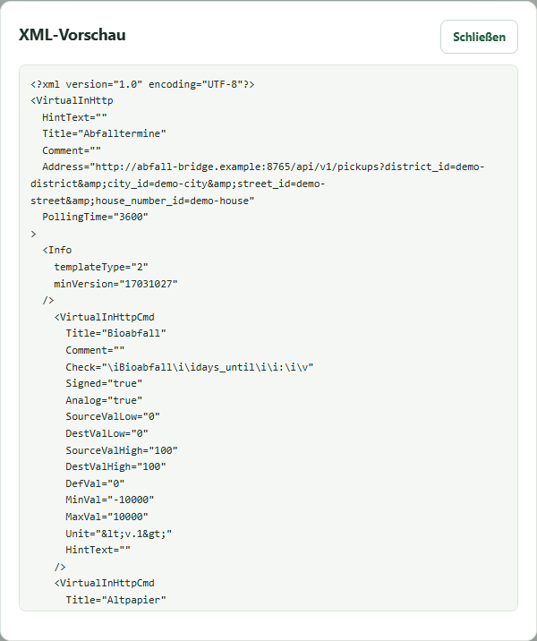

# Abfall OÖ Loxone Bridge

Bring Upper Austria waste collection dates into Loxone with a small service that reads and caches the Umweltprofis calendar. The German-language setup page helps you select your address and generate an XML template for virtual HTTP inputs in Loxone Config.

Built on [swagner's Home Assistant Abfall OÖ integration](https://github.com/swagner/ha-abfall-ooe); see [credits](#credits) for the two reused files and original license.

This is an unofficial integration, not an official Umweltprofis or Loxone product.

## What it does

- Returns the next collection date and days remaining for each waste type.
- Generates a Loxone XML template and a pickup URL for your selected address.
- Caches collection dates with daily refreshes.
- Runs on Raspberry Pi/Debian, Windows, or Docker, with an optional API key for pickups, logs, calendar interval choices, and starting address refreshes.



*Setup page from an earlier version, shown with invented address data and an example hostname. The current version generates URLs using address names and chooses the collection interval on the bridge.*

## Choose an installation

| Option | Best for | Requirements |
| --- | --- | --- |
| [Raspberry Pi / Debian](#raspberry-pi--debian) | A bridge that starts automatically and stays available to your Miniserver | systemd and Python 3.11+ |
| [Windows](#windows) | Local setup and trying the bridge on your PC | Python 3.11+ |
| [Docker Compose](#docker-compose) | An existing Docker host | Docker with Compose |

Download or clone this repository, then open its root folder. The commands below run from that folder. The default service port is **8765**.

### Raspberry Pi / Debian

On Debian or Raspberry Pi OS with Python 3.11 or newer:

```sh
sudo apt update
sudo apt install python3 python3-venv tzdata
sudo bash bridge/install_loxone_bridge.sh
```

Open `http://SERVER_IP:8765` from a device on the same home network. The bridge starts automatically at boot.

Installation does not contact Umweltprofis. On the setup page, use **Adressen aktualisieren** when you want to download the address list.

See the [installation guide](docs/INSTALLATION.md) for updates, migration, and removal.

### Windows

Install Python 3.11 or newer, then double-click **`tools/start-address-helper.bat`**.

The launcher creates a project-local Python environment, installs dependencies, **downloads the address list if it is missing**, and opens `http://127.0.0.1:8765`. If the download fails, use **Adressen aktualisieren** on the setup page to retry.

This launcher listens only on your PC. For access from a separate Loxone Miniserver, use a host reachable on your home network, such as the Raspberry Pi or Docker installation.

### Docker Compose

With Docker running, create your local settings file:

```sh
cp .env.example .env
```

On Windows PowerShell, use `Copy-Item .env.example .env` instead. Set an optional API key in `.env`, then build and start:

```sh
docker compose up -d --build
```

Open `http://SERVER_IP:8765` on your home network, or `http://localhost:8765` on the Docker host. Use **Adressen aktualisieren** to download the address list. Enter the configured bridge key first when required.

See the [Docker guide](docs/DOCKER.md) for settings, logs, updates, and using a published image once one is available.

## Connect Loxone

1. Open the bridge's setup page.
2. Load the address list if needed, then select your district, municipality, street or locality, and house number.
3. Enter the bridge address and port **as reachable from your Miniserver**. If authentication is enabled, enter the same API key configured on the bridge.
4. Select **XML herunterladen**. The bridge chooses the default collection interval automatically.
5. In Loxone Config, import the file through the templates for virtual HTTP inputs, review the address, and transfer your configuration to the Miniserver.

<details>
<summary>See the generated XML preview</summary>



*XML preview from an earlier version, using the same invented address. Current templates use address names and let the bridge choose collection intervals. This is the bridge's preview, not a screenshot of Loxone Config.*

</details>

You can also copy the generated pickup URL for your own HTTP integration. See the [Loxone notes](docs/LOXONE_BRIDGE.md) for address parameters and PicoC usage.

### API request URL

The setup page generates the complete URL. To build one manually, replace the placeholders in:

```text
http://{BRIDGE_HOST}:{PORT}/api/v1/pickups?district_name={DISTRICT_NAME}&city_name={MUNICIPALITY_NAME}&street_name={STREET_NAME}&house_number_name={HOUSE_NUMBER}
```

Use the bridge host reachable from the Miniserver and your configured port (default `8765`). Address values are names, not IDs; `city_name` means municipality. Names must match the calendar exactly, including capitalization. URL-encode each query value using standard UTF-8 encoding: spaces become `%20` or `+`, literal plus signs become `%2B`, and underscores remain underscores.

The bridge chooses the first interval offered by the calendar for each waste type. To override a choice in a manually built request, append `&intervals={URL_ENCODED_INTERVAL_SELECTIONS}`. Before encoding, this is a JSON object mapping waste-type names to interval names, for example `{"Restabfall":"4-wöchentlich"}`. If an API key is configured, also append `&key={URL_ENCODED_API_KEY}`. Replace these placeholders with encoded values, without the braces.

### Loxone HTTP input and commands

Use one **virtual HTTP input** with the complete pickup URL as its address. The generated template uses a polling interval of **3600 seconds**. Add an **analog virtual HTTP input command** for each waste type you want to display. These are the four commands included in the template; enter the command recognition expressions exactly as shown:

| Command title | Command recognition (`Check` in the XML) |
| --- | --- |
| Bioabfall | `\iBioabfall\i\idays_until\i\i:\i\v` |
| Altpapier | `\iAltpapier\i\idays_until\i\i:\i\v` |
| Restabfall | `\iRestabfall\i\idays_until\i\i:\i\v` |
| Gelber Sack | `\iGelber Sack\i\idays_until\i\i:\i\v` |

Each command reads `days_until` for its waste type: `0` means collection today, `1` means tomorrow. Keep the value mapping at `0 → 0` and `100 → 100`, as in the template. If your response uses another waste-type name, change the command title and the name inside the recognition expression to match its `by_waste_type` key exactly. Add further commands in the same way.

A missing waste type has no `days_until` value; do not interpret a missing reading as zero. The template does not include a stale-data alarm. Check `cache_stale` and availability separately if your automation depends on fresh dates, and verify how your Miniserver handles missing readings. See [the API guide](docs/LOXONE_BRIDGE.md) for response fields and troubleshooting.

## Configuration and network access

Keep the bridge on a trusted home network and do not forward its port to the internet. The optional API key protects pickup and log requests; the setup page and address lookups remain accessible without it. Starting a full address refresh and loading calendar interval choices require the configured key.

| Installation | Where to configure |
| --- | --- |
| Raspberry Pi / Debian service | `/etc/loxone-bridge/bridge.env`; restart `loxone-bridge` after changes |
| Docker Compose | `.env`; run `docker compose up -d` after changes |
| Manual Python launch | Environment variables or command-line options; see the contributor guide |

## Caching

Successful calendar fetches are reused for the Europe/Vienna day. Address and interval URLs use names; current upstream IDs are resolved internally. Failed lookups have bounded recovery and a short retry delay. Future cached dates survive ID changes and outages with an explicit stale status. Run one server process per data directory; see the [API and recovery details](docs/LOXONE_BRIDGE.md).

Saved calendars are automatically removed after 90 days without a request, plus a one-day grace period. Daily cleanup checks skip addresses with a lookup in progress. Requests served from cache also count as activity, so regular Loxone polling keeps your address active. Expired collection dates are excluded from responses; the shared address list is retained separately. See [inactive calendar cleanup](docs/LOXONE_BRIDGE.md#inactive-calendar-cleanup) for details.

The underlying calendar website can change independently of this project.

## Documentation

- [Installation and maintenance](docs/INSTALLATION.md) — Linux settings, updates, removal, and startup troubleshooting.
- [Docker guide](docs/DOCKER.md) — container settings, logs, updates, and published images once available.
- [Loxone and API guide](docs/LOXONE_BRIDGE.md) — setup details, endpoints, response examples, caching rules, and request troubleshooting.
- [Contributor guide](CONTRIBUTING.md) — manual launches, offline testing, and project structure.

## Development

With a Python environment active, run:

```sh
python -m pip install -r bridge/requirements.txt
python -m unittest discover -s tests -t . -v
```

Tests run offline using synthetic data. See the [contributor guide](CONTRIBUTING.md) before changing tests.

See [release preparation](docs/RELEASE_CHECKLIST.md) and [security reporting](SECURITY.md).

## License

This project is distributed under the [MIT License](LICENSE).

## Credits

Special thanks to **[swagner](https://github.com/swagner)** for the **[Home Assistant Abfall OÖ integration](https://github.com/swagner/ha-abfall-ooe)**. This bridge reuses two files from that project:

- [`bridge/abfall_ooe/api.py`](bridge/abfall_ooe/api.py) — the calendar client.
- [`bridge/abfall_ooe/parser.py`](bridge/abfall_ooe/parser.py) — the calendar HTML and JSON parser.

That code is copyright (c) 2026 swagner and is distributed under MIT. Its original notice is preserved in [bridge/abfall_ooe/LICENSE](bridge/abfall_ooe/LICENSE).
